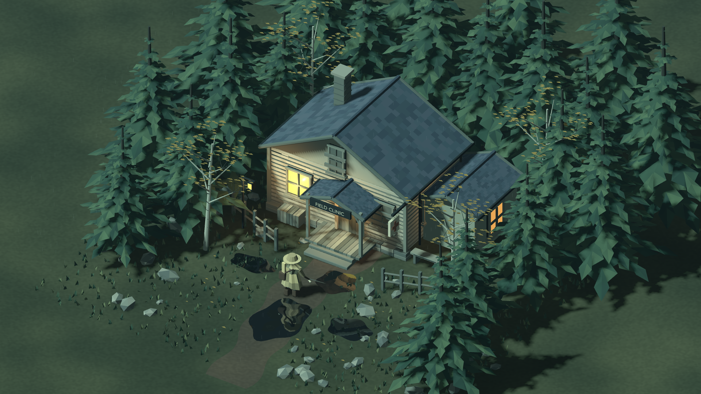

# Roguelike

Research and prototypes for an original isometric action roguelite set in a
storm-soaked boreal forest and abandoned rural clinic.

**Current status:** design exploration plus a playable graphics demonstration.
There is no implemented Souls-like combat, run progression or multiplier build
system yet. The final art direction has not been selected.

## Research

See the [report library](docs/README.md) for all six complete reports, four
concept boards and the [Storm Fresco engine comparison](docs/STORM_FRESCO.md).
Recommended reading order:

1. [Game loop and mechanics](docs/reports/game-loop-design-report.html)
2. [Four new art directions](docs/reports/new-art-directions.html)
3. [Affordable models and shader production](docs/reports/shader-production-guide.html)

The HTML reports are self-contained. Download a report and open it in a browser;
GitHub's file view shows source rather than the interactive document. No server
or network connection is needed to read a downloaded report. Concept studies
are explicitly labeled AI-generated, not engine renders. Mechanics and scope
recommendations remain proposals, not approved features.

## Forest / clinic art mock

A separate, non-playable scene with a modeled rural clinic, layered spruce and
birch trees, a cloaked traveler, warm windows and rain-disturbed puddles.
This is **actual Godot output from original Blender geometry**, not AI concept
art. The existing playable courtyard remains the default scene.



```sh
make import
make mock
```

See [captures, controls, rebuild commands and limitations](docs/FOREST_CLINIC_MOCK.md).
This is a model/composition study, not a final art-direction choice.

## Play the migrated Godot prototype

Install **Godot 4.5.1**, then run from this repository's root:

```sh
godot --headless --editor --import --path prototype
godot --path prototype
```

The checked-in assets are sufficient to play; Blender is only needed to
regenerate geometry. The demo has a running player, rain, wind, live planar
reflections and a toggleable glyph renderer. It is not the future forest/clinic
game and it does not use real-time ray tracing.

Controls: WASD/arrows move; Shift runs; Q/E orbit; mouse wheel zooms; 1–4 toggle
glyphs/rain/wind/reflections; L toggles the lamp; R resets position; H/Escape
toggles the HUD. See the [prototype guide](prototype/README.md) for details,
exports and performance caveats.

### Optional Linux x86_64 setup

```sh
bash prototype/tools/setup_linux.sh
export PATH="$HOME/.local/bin:$PATH"
python3 -m pip install gdtoolkit==4.5.0 pre-commit==4.6.2
pre-commit install
```

Use a virtual environment or `pipx`/`uv tool install` if your Python installation
is externally managed. The installer verifies the official Godot/Blender
download checksums. Export templates are optional and installed separately with
`python3 prototype/tools/setup_exports.py`.

## Rebuild and check

```sh
make rebuild-assets   # Headless Blender 4.5.3, then Godot import
make check            # Report checks, Python/shell syntax, GDScript lint/format,
                      # Godot import/parse and headless movement/effect smoke tests
make render-check     # Actual shader/reflection pixels under Xvfb/OpenGL
make rebuild-mock     # Regenerate the separate forest/clinic Blender kit
pre-commit run --all-files
```

The Makefile needs GNU Make and Bash. `render-check` additionally needs Xvfb,
`xauth`, and OpenGL libraries; its PNG/log output goes into ignored `artifacts/`.
Godot's Compatibility renderer can use software OpenGL, but hardware and mobile
performance are not established. Report checks use only Python's standard
library; no JavaScript build, backend or dependency installation is required to
read reports or play the demo.

## Layout and provenance

```text
docs/            Complete research reports, comparison boards and their index
prototype/       Standalone Godot project, assets, shaders, Blender tools, tests
tests/           Offline report-library regression tests
.github/         Research and Godot CI checks
```

The prototype was copied from
[noimnotahuman](https://github.com/AlexAlexBabarika/noimnotahuman/pull/27).
The original repository is unchanged. See [migration provenance](docs/MIGRATION.md)
for the source revision and archive boundaries. Third-party reference credits
remain in the reports; those reference images are not licensed production game
assets merely because they appear in a research document.
