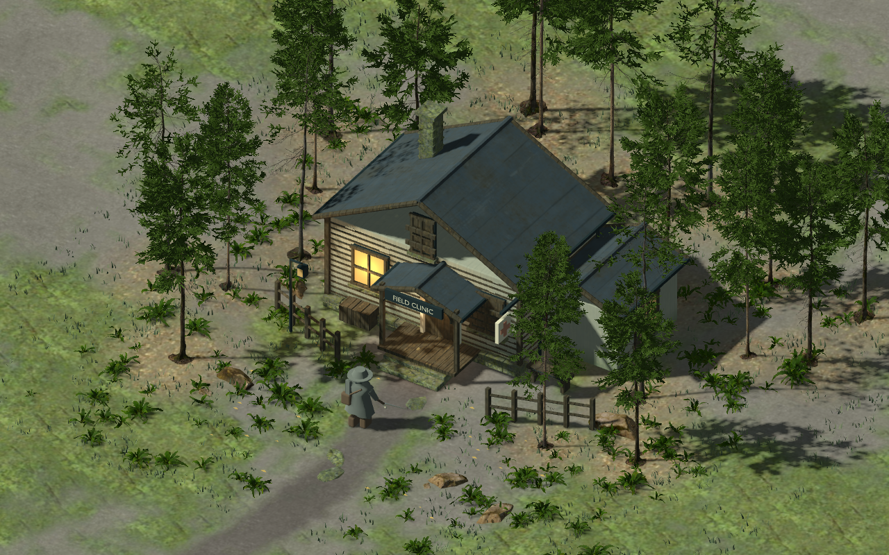
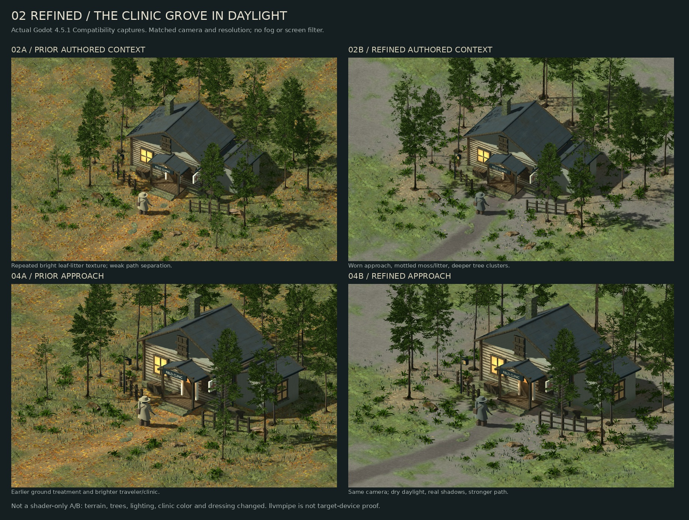
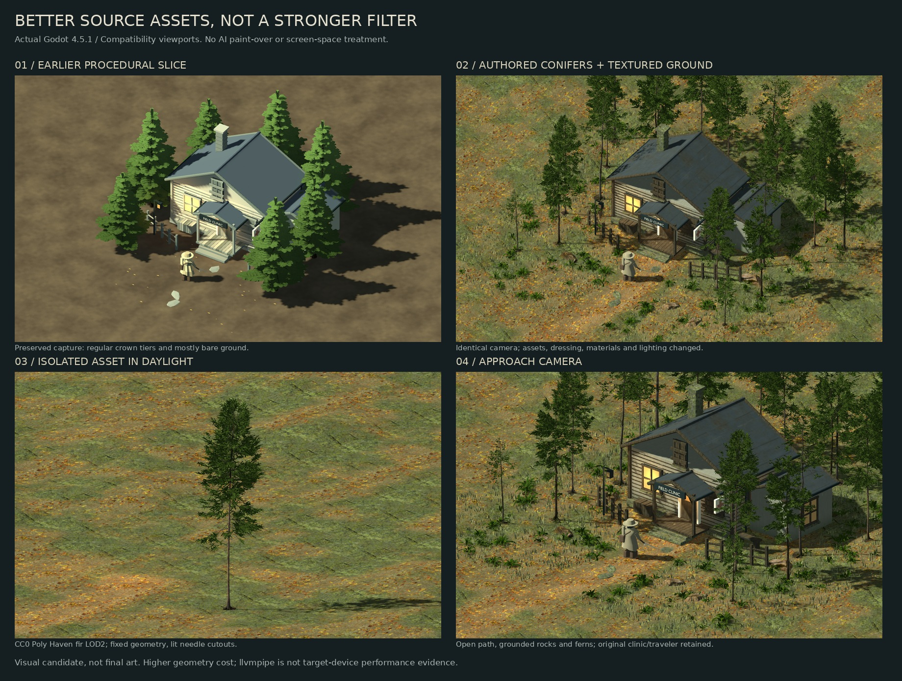

# Clinic grove — authored asset / daylight revisions

This is a visual candidate after the user rejected both the painted
I1 filter and the regular, tiered procedural spruces. The change is primarily
**better source assets and surface treatment**, not a shader that hides arbitrary
low-poly meshes. The playable `res://main.tscn` is unchanged.



## Panel 02: matched refinement



The earlier [02 daylight](screenshots/clinic-grove-v1/daylight.png) and
[approach](screenshots/clinic-grove-v1/approach.png), plus their JSON sidecars
and the other three earlier views, remain under `clinic-grove-v1`. The new
[02 daylight](screenshots/clinic-grove/daylight.png) and
[approach](screenshots/clinic-grove/approach.png) have the **same orthographic
camera settings and resolution** as the originals. The board resizes them,
but does not retouch or filter any viewport. This is not a shader-only A/B:
terrain, deterministic tree placement, understory, material colors and
daylight balance all changed together.

- A worn dirt corridor now leads to the entrance with moss/litter gathered
  beyond its edges and under the firs, rather than one repeated bright carpet.
- The three already-licensed Poly Haven ground color/normal maps are blended
  into a fixed world-space terrain field **offline**, sampled at runtime as
  two mipmapped textures. A triangular random-patch arrangement reduces obvious
  tiling without blurring tree geometry or applying any screen filter. It
  borrows the patch-blending idea of [Heitz & Neyret's 2018 study](https://eheitzresearch.wordpress.com/722-2/),
  but does **not** implement their histogram-preserving transform; soft blends
  can still lose texture contrast. The tree positions and input/output SHA-256
  fingerprints are recorded in the [terrain manifest](../prototype/assets/grove-terrain/terrain.json).
- The foreground and distant trees are regrouped at the same camera; grass and
  ferns are sparser along the route. The lights remain dry daylight, real cast
  shadows and lit materials; no weather is required to read the scene.
- Clinic colors and roof texture contrast are restrained. This is surface
  treatment, **not** a new clinic/traveler mesh. Their simple silhouettes remain
  the main visual weakness and still need authored replacements.

Rebuild the derived terrain (NumPy + Pillow required **only** to rebuild):

```sh
python3 prototype/tools/build_grove_terrain.py
make import
```

The input source URLs/authors/licenses and adaptation notes are in the
[CC0 asset notes](../prototype/assets/reference-forest/README.md). Committed
runtime JPEGs suffice for viewing the scene; NumPy is not a Godot dependency.

## Original authored-asset revision

## What changed

- Three CC0 **artist-authored Poly Haven conifers**, selected from their LOD2
  meshes: asymmetric crowns, small branchlets, natural gaps, textured bark
  and fixed needle geometry. These are not Valheim assets or AI meshes.
- Texture/normal-mapped leaf litter and moss on a slightly raised terrain edge;
  worn clearing, small grass blades, mossy rocks and four fern variants.
- Weathered projected wood, stained limewash, restrained slate-roof weathering,
  textured stone and less neon window color on the original clinic.
- Nineteen staggered tree placements frame an open approach. The **context
  camera is unchanged** from the earlier structured-forest capture so the
  result can be compared without a framing trick.
- Ordinary lit materials, alpha scissoring, mipmaps and directional shadows.
  Dry daylight is the default: no fog, rain, reflection pass, screen filter,
  depth-of-field, image generation or paint-over.

## Compare the actual engine output



The board only resizes/arranges captures. Top row: identical orthographic
camera and resolution, **but assets, materials, dressing and light balance
all changed**. This historical comparison is also not a controlled shader-only
A/B experiment. Bottom: an isolated tree and the approach camera. Originals
and JSON sidecars are under `clinic-grove-v1`; the latest capture set is:

- [Dry daylight context](screenshots/clinic-grove/daylight.png) / [provenance](screenshots/clinic-grove/daylight.json)
- [Isolated tree](screenshots/clinic-grove/tree.png) / [provenance](screenshots/clinic-grove/tree.json)
- [Same-tree silhouette](screenshots/clinic-grove/silhouette.png) / [provenance](screenshots/clinic-grove/silhouette.json)
- [Closer approach](screenshots/clinic-grove/approach.png) / [provenance](screenshots/clinic-grove/approach.json)
- [Optional weather, context camera](screenshots/clinic-grove/weather.png) / [provenance](screenshots/clinic-grove/weather.json)

Earlier [structured slice](STRUCTURED_FOREST.md), [rejected I1](PAINTED_FOREST.md)
and [G1/M1 experiments](style-study.md) remain intact as historical evidence.
The source and processed asset attribution is in the
[CC0 asset notes](../prototype/assets/reference-forest/README.md).

## Run / reproduce

```sh
make clinic-grove
# 1 context, 2 isolated tree, 3 approach; Q/E orbit; wheel zoom
# I isolate, S silhouette, L shadows, T weather, Space pause, H HUD

python3 prototype/tools/capture_clinic_grove.py
python3 docs/tools/build_clinic_grove_board.py
python3 docs/tools/build_clinic_grove_refinement_board.py
make grove-render-check
```

The checked-in assets suffice; rebuild instructions are in the asset notes.
Each capture records engine, renderer/device, orthographic camera, wind/weather/
shadow state, asset-manifest hashes, scene/shader hashes and the captured PNG
fingerprint. Refined captures also record the baked terrain manifest fingerprint,
light energy and placement count. Native render checks verify actual light/shadow pixel changes,
visible terrain with upward-facing normals, texture mipmaps, deterministic
placements, wind uniforms, non-billboarding and optional weather/isolation.

## Honest limits

- This removes the old regular crown tiers and bare floor. It does **not**
  establish a finished Souls/Pathologic/NieR art direction: the cottage-like
  clinic silhouette and simple traveler remain the weakest, mismatched assets.
- The 2048px terrain field spans 64m and will repeat outside those bounds.
  It is a fixed look-dev slice, not a tiled/infinite production terrain solution.
- The offline bake spends storage and texture memory instead of fragment-shader
  work; target-device memory and frame time are not measured here.
- Photo-derived foliage can shimmer at distance. These checks do not establish
  subtle temporal stability or full combat readability; no combat is added.
- About **1.04M full-detail tree triangles** across nineteen placements before
  Godot's generated LODs, versus roughly 154k in the earlier seven-tree slice.
  Better source geometry is doing real work here; this is not a free shader fix.
- Compatibility/llvmpipe screenshots demonstrate renderer behavior only.
  Target-device frame time, memory, alpha overdraw and production LOD budgets
  remain unvalidated. Do not adopt the whole grove as an optimized game level.
- The optional weather view is secondary evidence, not a way to conceal the
  daylight asset quality. The default game launch is still the playable demo.
