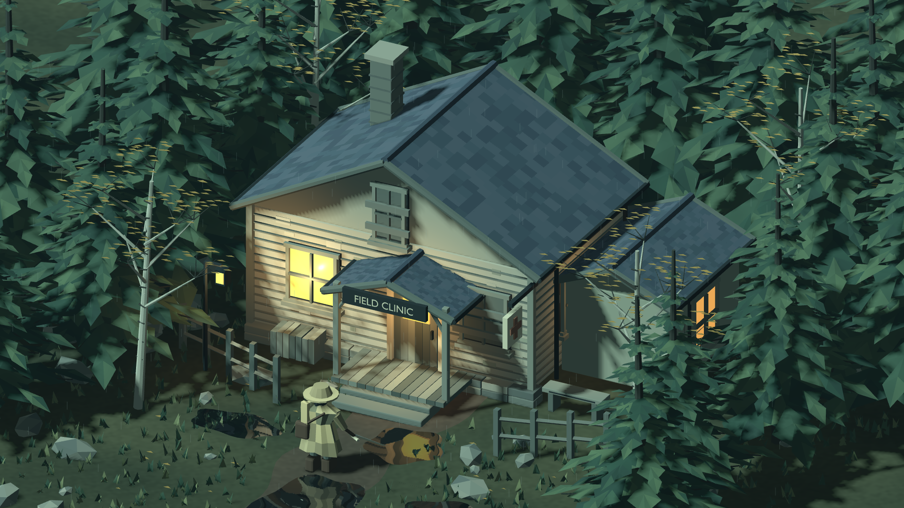
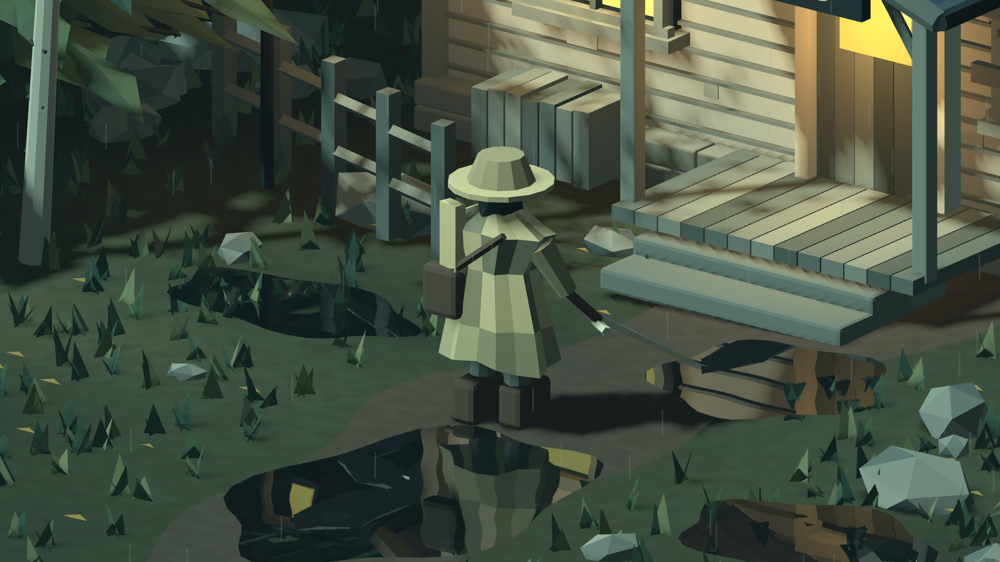

# Forest / field clinic — art mock

A new, deliberately small model-and-lighting study following the coarse
Storm Fresco treatment tests. This pass works on the actual forms rather than
adding another full-screen print effect. It is **not a final style selection**.

## Actual Godot output






These are untouched 1920×1080 engine PNGs, not AI-generated images, Blender
beauty renders, or overpainted screenshots. Captured with Godot 4.5.1's
Compatibility renderer and Mesa llvmpipe software OpenGL. Four-sample MSAA is
enabled for this scene. Hardware/mobile performance is **not established**.
Source hashes and the exact camera/weather settings are recorded in
[provenance](screenshots/forest-clinic/provenance.json).

## What changed

- **Clinic:** gabled silhouette, individual staggered slate courses, inset
  mullioned windows, boarded openings, siding, chipped limewash, stone base,
  porch braces/boards/steps, chimney, entrance lettering and medical sign.
- **Forest:** asymmetrical drooping boughs instead of stacked cones; pale
  birches with bark marks, sparse October leaves, stones, grass and fences.
- **Traveler:** folded ochre cloak, wide hat, dark face, scarf, satchel, boots
  and a tapered blade. The brighter silhouette is kept against the dark path.
- **Lighting/materials:** a cool exterior against warm interior panes and
  local light pools; continuous ground pigment rather than floor bands;
  restrained geometric rain, gentle branch displacement and puddle ripples.
- **Reflections:** a half-resolution mirrored camera sampling the same world,
  excluding ground/water/rain layers. This is not ray tracing or GI. Local
  window lights and the traveler fill are authored, not emitted-light bounce.

All geometry is procedurally modeled by the checked-in Blender script, seed
`40217`. No downloaded mesh, image texture or AI concept is used. The clinic
lettering is converted to mesh from Blender's bundled font. The GLB contains
nine named mesh groups; [asset metadata](../prototype/assets/forest-clinic.json)
records pre-triangulation Blender counts, not engine draw calls or budgets.

## Run

From the repository root, with Godot 4.5.1:

```sh
make import
make mock
```

The checked-in asset is sufficient; Blender is not required to view it.

| Input | Action |
| --- | --- |
| 1 / 2 / 3 | Wide / clinic / traveler camera presets |
| Q / E | Orbit around the current focus |
| Mouse wheel | Zoom |
| R | Toggle visible rain streaks |
| F | Toggle puddle reflections and the additional camera render |
| Space | Freeze / resume the weather clock and keyboard orbit |
| H | Hide / restore labels |

The original courtyard remains `project.godot`'s main scene. `make play`
still launches it. No gameplay, collision, rigging or character movement is
implemented in this mock; navigation controls are only for inspecting art.

## Reproduce

With Blender 4.5.3 LTS, Godot 4.5.1 and the existing repository tools:

```sh
make rebuild-mock
make check
make render-check
```

To refresh all three archived captures and their source hashes together:

```sh
python3 prototype/tools/capture_mock.py
# Displayless Linux: append --xvfb
```

Capture one camera (absolute output path; its parent must exist):

```sh
godot --audio-driver Dummy --path prototype --resolution 1920x1080 \
  res://mock_scene.tscn -- --view=wide --capture=/absolute/path/wide.png
```

Repeat with `--view=clinic` and `--view=traveler`. Capture mode hides labels,
freezes all shader clocks at 6 seconds and settles 20 frames before saving.
On a displayless Linux machine, prefix the command with
`xvfb-run -a -s '-screen 0 1920x1080x24'`.
`--dry`, `--no-wind` and `--no-reflections` provide diagnostic variants.
An identical toolchain/driver is needed for pixel-identical output; geometry
is seeded, but screenshots can differ across graphics backends.

`make check` parses/imports and exercises mock presets, weather/pause/HUD/zoom
controls, layer isolation and reflection-camera geometry. `make render-check`
also compiles/draws the new shaders under real OpenGL, checks pixel changes
from rain/reflection toggles, and retains the original courtyard regression.
These are automated checks, not recorded human playtesting.

## Remaining weaknesses

- Tree boughs remain angular and repetitive up close; the forest is a backdrop,
  not a reusable production foliage kit or a tested occlusion solution.
- The clinic is still too intact to establish abandonment through geometry
  alone. Interior dressing, large structural damage and narrative props are
  future work; warm windows are a composition device, not an approved story.
- The traveler has no rig, attack animation or facing/telegraph validation.
  Its silhouette has only been judged in the saved views.
- Rain is intentionally sparse. No volumetric storm, wetness accumulation,
  contact-shadow system, baked lighting or final post-processing is claimed.
- Close-up inspection is not a target-device performance benchmark. Visibility
  culling, LODs, collision, animation, combat readability and motion remain open.
