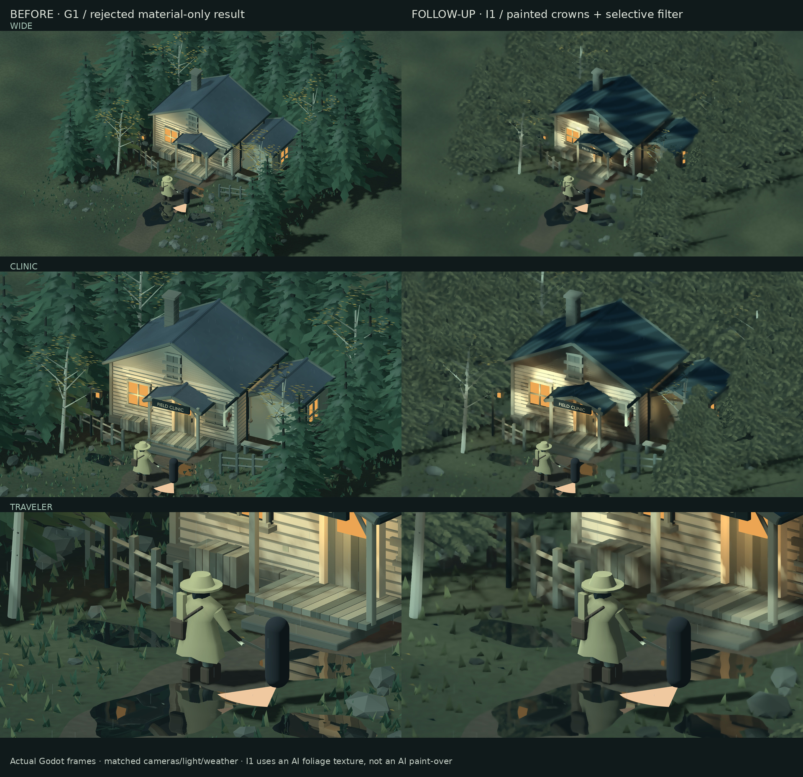

# Historical experiment — rejected

I1 was rejected because its repeated painted crowns and screen filter destroyed
recognizable tree structure. Preserved below without changing the old evidence.
The current candidate is the [structured daylight forest](STRUCTURED_FOREST.md).

# I1: a visibly stronger painted-forest treatment

The previous material-only result was rejected for still looking low-poly. **G1 is not an accepted final direction.** I1 replaces the exposed spruce silhouettes as well as changing surface shading. It is a materially different candidate, not blanket art-direction approval.



This board only labels and resizes actual engine frames; it is not an AI paint-over. Original full-resolution frames and per-shot metadata are in [the capture directory](screenshots/style-study/). The original GLB, prepared GLB, historical screenshots and default playable scene remain unchanged.

## What actually changes

- **Silhouettes:** original triangle-bough surfaces are discarded in I1. 1,254 vertical-axis-facing foliage cards use four painted stamps and the original 22 deterministic tree anchors. These cards are unlit and do not cast shadows: painted massing, not physically based foliage. This is additional foliage representation, not a shader magically repairing arbitrary geometry.
- **Materials:** a broad world-position ink wash replaces small pigment noise on environment meshes. Clinic slate is classified by its actual material name; the earlier nonexistent `Roof` group did not bind the intended special treatment.
- **Screen pass:** four 3×3 local regions are merged according to color variance (36 color samples plus protection/original reads per output pixel), with a radius of 3.5 pixels at 720p, scaled with height. This is a painterly approximation, **not a depth-aware production Kuwahara implementation**.
- **Selective sharpness:** a separate silhouette viewport protects traveler/blade, enemy/warning probes, warm windows, clinic sign and rain. Its camera frustum matches the main camera even under letterboxing. No normal/roughness texture dependency; works with the project's Compatibility renderer.

The foliage texture source was generated with `gpt-image-2.5-flare`, then chroma-keyed, despilled and palette-remapped. Its committed source and processed atlas hashes are recorded in `prototype/assets/painted-crowns.json`. This is **AI-assisted texture evidence, not representative AI-generated mesh evidence**. The 3D geometry is still the procedural Blender stand-in.

## Reproduce and inspect

```sh
make import
make style-study  # I1; default playable scene is unchanged
godot --path prototype res://style_study.tscn -- --arm=I1
# Same scene/materials/cards, without the screen filter:
godot --path prototype res://style_study.tscn -- --arm=I1 --no-paint

python3 prototype/tools/build_painted_crowns.py
python3 prototype/tools/capture_style_study.py painted
python3 prototype/tools/build_painted_board.py
make style-render-check
```

Atlas/board generation requires Pillow; capture uses Xvfb, Godot and the checked-in assets. **P** toggles only the screen filter. **1–3** select wide/clinic/traveler, **Q/E** orbit, wheel zooms, **Space** freezes, **R/F** toggle rain/reflections and **H** hides the HUD. The native footer explicitly labels the AI texture and non-gameplay scope.

The eight stills use identical presets, clock 6, lights, fog, seed, rain, wind and reflections to the historical G1 controls: three views at 1920×1080 and 1280×720 plus wide/traveler filter-off diagnostics. [Painted provenance](screenshots/style-study/painted-provenance.json) records image/source hashes and flags. [Board provenance](screenshots/style-study/painted-board.json) records the six source hashes. The existing G1 wide frame also reproduced byte-identically with this implementation.

## Validation and limits

Rendered regression checks toggle P at a frozen clock. Protected interior pixels have zero mean change; background mean RGB changes approximately 0.014 on a 0–1 scale, both letterboxed and stretched. Tests also check the card count and that the roof classifier actually binds. This checks selectivity, not aesthetic quality.

Native visual testing verified all three cameras, orbit, zoom, pause, rain/reflections, P, H and narrower letterboxing. A missing footer was found and corrected; a fresh native recheck verified controls/provenance in maximized, normal and narrower windows.

**Remaining visual problems:** repeated foliage stamps can look mottled and overly soft; conical crown massing remains. Close grass, steps, fence and traveler still expose inexpensive geometry. This is a stronger painted treatment, not a finished Dark Souls / Pathologic 2 / NieR Replicant-quality asset set.

**Remaining technical gaps:** subtle billboard popping, alpha shimmer and filter stability are inconclusive. Mask copies are static, omit world occluders, and are not a validated animated-gameplay render layer; occluded/animated actors require a proper production mask path. No combat or animated-enemy validation. Extra card overdraw, mask rendering and the 36-sample screen filter require target-hardware profiling. Mesa llvmpipe software output is **not performance evidence**. Earlier Test 1/Test 2 measurements and conclusions remain historical, not I1 scores.
