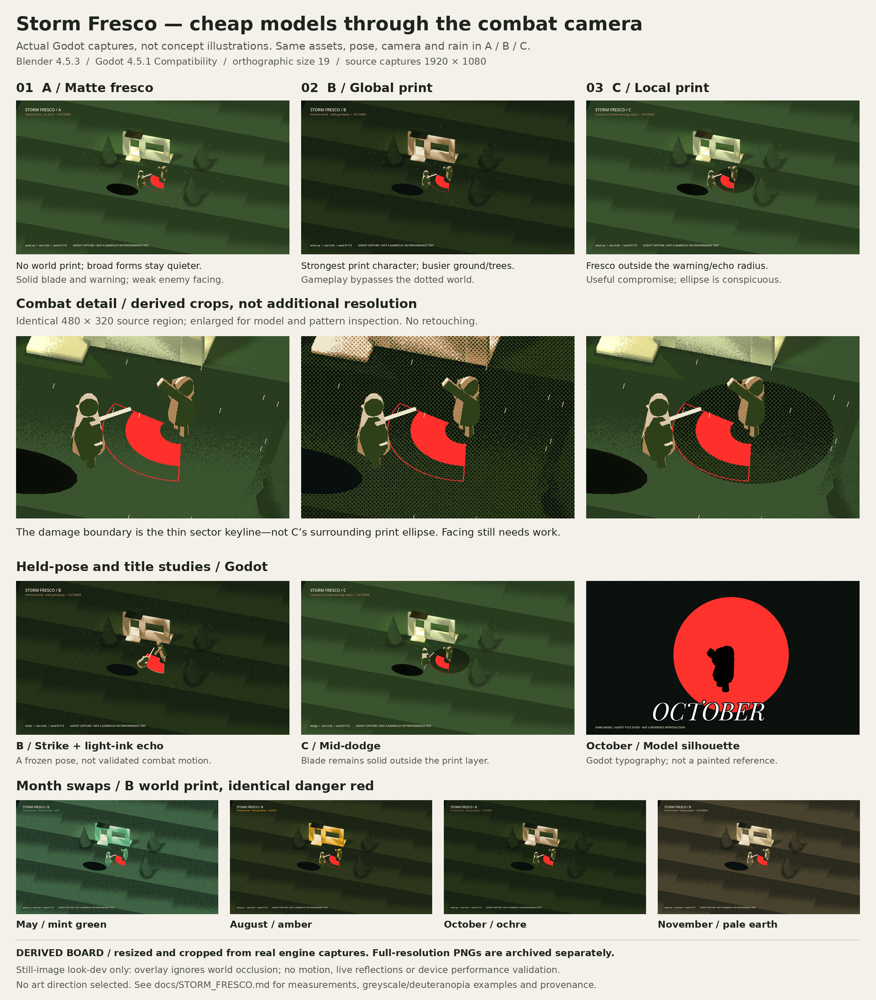

# Storm Fresco: engine screenshot comparison

This curated set moves the [shader production research](reports/shader-production-guide.html)
from aspirational illustrations to deliberately coarse models rendered in Godot.
It is **still-image look-dev evidence, not final game art or validated combat**.
The existing `prototype/` is unchanged; these images came from a separate
experimental project, not the playable courtyard demo.



The board follows the earlier boards' cream background, numbered treatments and
captioned panels. Unlike the earlier AI concept studies, its source images are
actual engine captures. The board is a **derived JPEG**: full-frame images are
downsampled and the combat details are enlarged crops, with no retouching or
additional resolution. Use the original PNGs for pixel-level judgments.

## Selected images

Nine original Godot PNGs are preserved at **1920×1080**, plus two explicitly
derived accessibility examples. Source capture bytes are unchanged.

| Image | What it tests |
| --- | --- |
| [A: matte fresco](screenshots/storm-fresco/A_october_wind_up.png) | Quiet world shading, with a solid blade and warning. |
| [B: global print](screenshots/storm-fresco/B_october_wind_up.png) | Four ink bands and 45° halftone applied to the world only. |
| [C: local print](screenshots/storm-fresco/C_october_wind_up.png) | Matte world outside the warning/echo radius; print inside. |
| [B: strike + echo](screenshots/storm-fresco/B_october_strike_echo.png) | Full warning fill, light-ink offset echo and a held strike pose. |
| [C: mid-dodge](screenshots/storm-fresco/C_october_mid_dodge.png) | A held dodge pose and a solid weapon against local dots. |
| [May](screenshots/storm-fresco/B_month_may.png) | Mint-green/light-green world inks. |
| [August](screenshots/storm-fresco/B_month_august.png) | Amber light ink with a dark field. |
| [November](screenshots/storm-fresco/B_month_november.png) | Pale earth inks. The October baseline above completes the four-month set. |
| [October title study](screenshots/storm-fresco/B_october_title_card.png) | The imported enemy model as a black silhouette against a shader-generated red disc; Godot-rendered Playfair Display Italic type. |
| [Derived C greyscale](screenshots/storm-fresco/derived_greyscale_C_october_wind_up.png) | Linear-light Rec.709 luminance, encoded back to sRGB. |
| [Derived C deuteranopia simulation](screenshots/storm-fresco/derived_deuteranopia_C_october_wind_up.png) | Machado, Oliveira & Fernandes (2009), severity-1 matrix applied in linear light, clipped and re-encoded to sRGB. Not accessibility certification. |

### What the stills suggest

- **A** preserves environmental forms most clearly. The primitive construction
  and repeated ground-shading bands are still visible.
- **B** has the strongest print identity, but the dots add noise to the ground,
  tree silhouettes and thin warning edges.
- **C** keeps quieter surroundings while retaining the print accent. Its
  projected elliptical print window is conspicuous and is **not the damage
  boundary**; the thin sector keyline defines that boundary.
- The blade is visible in greyscale. Enemy facing remains ambiguous at the
  standing player's approximately **119-pixel** height. May/November warning
  edges need stronger greyscale contrast. These are conservative visual
  judgments; a human should confirm them before selecting a style.

## Capture conditions and evidence boundary

- Blender **4.5.3 LTS**; Godot **4.5.1.stable.official.f62fdbde1**.
- Compatibility renderer, real window/OpenGL capture under Xvfb with Mesa
  llvmpipe. Software rendering does not establish target-device performance.
- Combat camera matches the repository prototype: orthographic size **19.0**,
  yaw **16.0428°**, elevation **39.8056°**, pixel-snapped camera-plane position.
  Title framing intentionally zooms to size **6.2**.
- A/B/C wind-up captures use identical assets, camera, pose, October palette,
  rain amount **0.65**, seed **81173** and warning fill **0.6**. The strike
  warning uses fill **1.0**. Rain is 48 seeded, fixed-angle solid streaks.
- World SubViewport → print TextureRect; a separate transparent overlay holds
  actors, warnings and rain; UI sits above both. **The overlay ignores world
  occlusion**; there is no shared-depth or cutaway implementation.
- The coarse actors share a seven-joint rig with rigid one-bone weights. The
  pose clips are held snapshots, not complete animated combat actions. The
  player uses borrowed ellipsoid normals on hood/coat. Imported normal and
  RGBA mask counts were validated.
- RGBA vertex masks encode patch variation, per-part height gradient (not
  baked AO), authored rain exposure and dihedral-curvature edge wear.
- The actor shader uses authored lamp-position banding, not the world's
  physical light/shadow response. Actors bypass halftone and use the month
  field ink as their darkest gameplay tone; black is reserved for the title
  silhouette. The puddle is a static dark mesh, not a live reflection.

No final art direction, animation quality, combat readability in motion, mobile
viewport suitability or shader/device budget is established by this set.
Run/turn clips, moving-lamp sequences, live reflections and real combat remain
untested. Strengthen enemy-facing cues and warning edges, then test motion and
occlusion at the smallest intended viewport before adding more weather.

## Measurements from the full local experiment

These results describe the **full 63-capture suite**, not a rerun from the
curated files in this PR. Only the selected images are archived here; pan pairs,
warning ID passes and raw/proxy lamp diagnostics are not included. The original
result values are recorded in [provenance](screenshots/storm-fresco/provenance.json).
The omitted diagnostics cannot be independently remeasured from this subset.

| Test | Result | Scope |
| --- | --- | --- |
| Anchored camera pan | Mean RGB absolute difference **0.0004553 / 255**; changed pixels **0.0012369%** | Fixed orthographic camera translated 37 px; second image aligned back, common 1823×1020 interior crop. |
| Unanchored camera pan | Mean RGB absolute difference **15.0257587 / 255**; changed pixels **42.3333118%** | Same capture/alignment; comparison in sRGB, changed means maximum channel difference >1/255. |
| Danger-red leakage | **0 pixels / 0%** outside matching warning-only ID masks | All five October B combat stills and four B month swaps; deliberately red title disc excluded. |
| Borrowed normals | **12,782–17,144** differing pixels across raw/proxy lamp comparisons | A/B at four lamp azimuths; proves a rendered difference, not artistic superiority. |

The initial warning ID pass incorrectly retained the print shader and was
invalid. It was corrected to a black background with white warnings and
rerendered before these results were accepted. The mask footprint assertion
rejects a full-frame mask. Export validation also caught and corrected an
all-white `COLOR_0` placeholder and unwanted extra color attribute.

## Provenance and board reproduction

Source: [the Storm Fresco look-dev session](https://app.devin.ai/sessions/5d876fef59694cb9b9b23a09e4e845b8).
Per-image classification, camera/pose/rain metadata and SHA-256 fingerprints
are in [provenance.json](screenshots/storm-fresco/provenance.json); the library's
[manifest](manifest.json) fingerprints the board, captures and supporting files.
No supplied reference JPGs or AI-generated images are included in this set.
The earlier HTML reports and concept boards remain unchanged.

This PR archives **evidence only**: it does not include the full Blender/Godot
look-dev project or its engine-rendering scripts. The local experiment was built
with `blender -b -P blender/build_assets.py`, then `bash tools/render_all.sh`;
those commands are provenance, not commands available in this repository.
Playfair Display is credited in the title study, but no font binary is added.

Rebuild the derived board from the committed PNGs, using Python with Pillow
and DejaVu Sans/DejaVu Sans Bold installed:

```sh
python3 docs/tools/build_storm_fresco_board.py
# Optional on other systems:
python3 docs/tools/build_storm_fresco_board.py --font-dir /path/to/dejavu
```

The script does not modify its inputs. A regeneration that changes the board
bytes requires updating that board's SHA-256 entry in `docs/manifest.json`.
