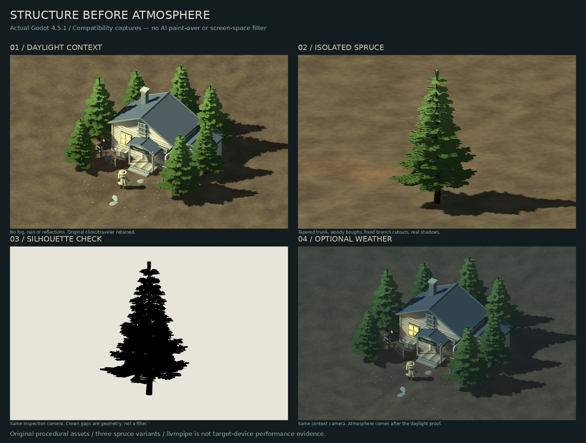

# Structured forest slice — daylight first

**New candidate, not an accepted final art direction.** The earlier G1 material
change was insufficient; I1's painted crowns and screen filter were rejected.
Both experiments and all historical captures remain untouched. This scene starts
over with asset structure and ordinary lighting, not another image treatment.



## What changed

- Three original, deterministic spruce variants, 7.2–9.5 m tall, placed as a small
  seven-tree grove around the earlier clinic and traveler stand-ins.
- Tapered trunk, exposed lower twigs, drooping primary boughs and paired lateral
  shoots. Fixed bent/crossed branch cutouts follow the wood, not the camera.
- A procedural needle/branch atlas, alpha scissor rather than translucent blend,
  actual texture mipmaps and softened upward/radial foliage normals. These are
  conventional foliage production techniques, not a full-screen disguise.
- Lit matte needles, smooth wood normals and restrained bark variation. Two-sided
  alpha-cutout shadow casting; 2048 directional shadow atlas; 2x MSAA. Bias avoids
  the shadow acne found in the first daylight render.
- Dry, fog-free daylight is the default. No bloom, painterly filter, puddles or
  reflections. Optional weather is a secondary view, not a way to hide geometry.
- Earth-colored forest floor and a subtle worn path. The clinic, traveler and
  props are reused, not new production-quality assets.

The daylight images show recognizable conifer structure and attached shadows
instead of a mottled screen-space crown. The close view also exposes the current
limits: tier repetition, flat cutout edges and a relatively uniform silhouette.
This is a stronger asset foundation, **not proof that arbitrary AI meshes can be
rescued by a shader**, and not a claim to match Valheim's finished environment art.

## References and what is borrowed

- **Valheim:** economical but intentional tree silhouettes, branch hierarchy,
  lighting and grounded shadows. [Official screenshots](https://store.steampowered.com/app/892970/Valheim/),
  [art-director interview](https://www.sportskeeda.com/esports/news-the-story-deathsquitoes-rule-cool-valheim-s-journey-robin-eyre-art-director-creative-lead-sportskeeda-exclusive).
- **The Long Dark:** restrained texture inside clear silhouettes, rather than
  blurring silhouettes into the background. [Art-process reference](https://www.creativebloq.com/how-to/how-to-create-stylised-game-artwork).
- **Death's Door:** orthographic composition and an unobstructed character/path.
- **Dark Souls / Pathologic 2 / NieR Replicant:** the intended mood remains worn,
  rural and uneasy. Daylight is deliberately diagnostic, not the final storm grade.

These are visual/production references, not claims about the games' exact shader
source. No publisher screenshot, downloaded game mesh or AI image is used as an
asset. All screenshots here are raw Godot output from the checked-in scene.

## Run and inspect

```sh
make import
make forest-slice
```

| Control | Action |
| --- | --- |
| 1 / 2 / 3 | Context / single-tree camera / grove detail |
| Q / E; wheel | Orbit; zoom |
| I | Isolate the hero tree |
| S | Silhouette-only hero tree |
| L | Toggle cast shadows |
| T | Toggle secondary rain/fog conditions |
| Space / H | Pause wind/orbit clock; hide HUD |

Silhouette mode hides the floor and clinic, not the branch cutouts. Isolation
suppresses weather. Views are inspectable studies, not playable combat scenes.
The existing playable `res://main.tscn` and historical study scene are unchanged.

## Rebuild

Blender 4.5.3 LTS and Python/Pillow are only needed to regenerate the source assets:

```sh
make forest-assets
make import
python3 docs/tools/build_structured_forest_board.py
```

`prototype/tools/build_spruce.py` uses seed 74013. The atlas is built first with
`--atlas-only`; Blender generates/export the geometry in the second step.
`prototype/assets/structured-spruces.json` records asset/atlas SHA-256 and counts.
Each tree is about **20.6–24.9k triangles before imported LODs**. The seven-tree
placement is about 155k tree triangles at full detail. This deliberately spends
geometry on structure; no LOD/overdraw budget has been validated for a production
forest. Shader-only changes on the earlier weak meshes were not enough.

Example reproducible capture (start from repo root; create the output folder first):

```sh
xvfb-run -a godot --audio-driver Dummy --disable-vsync --resolution 1280x800 \
  --path prototype res://forest_slice.tscn -- --view=tree --isolated --no-wind \
  --capture=/absolute/output/spruce.png
```

The capture writes PNG plus JSON with camera, engine/device, daylight/weather
state, shadow settings and SHA-256 for the image and source assets. Available
views: `wide`, `tree`, `grove`; modifiers: `--isolated`, `--silhouette`,
`--weather`, `--no-shadows`, `--no-wind`. Archived captures are under
`docs/screenshots/structured-forest/`. Only the daylight/weather pair is a strict
same-camera comparison. This rebuilt slice changes assets, placement and lighting,
so it is **not** a controlled shader A/B against the older G1/I1 evidence.

## Validation and limits

`make forest-render-check` checks real pixel changes from disabling shadows and
sunlight, tree response to light, retained mesh counts, fixed tree transforms
during camera orbit, mipmaps, isolation and weather restoration. The repository
suite also checks GLB triangle counts and all capture fingerprints.

These checks prevent broken rendering; they do not certify attractive art.
Subtle shimmer/overdraw, billboards viewed edge-on, dense forest readability,
enemy facing, animation and combat remain unvalidated. Native UI/recorded motion
and representative hardware performance are separate follow-ups. Compatibility
renders on Mesa llvmpipe are **not target-device performance evidence**.
